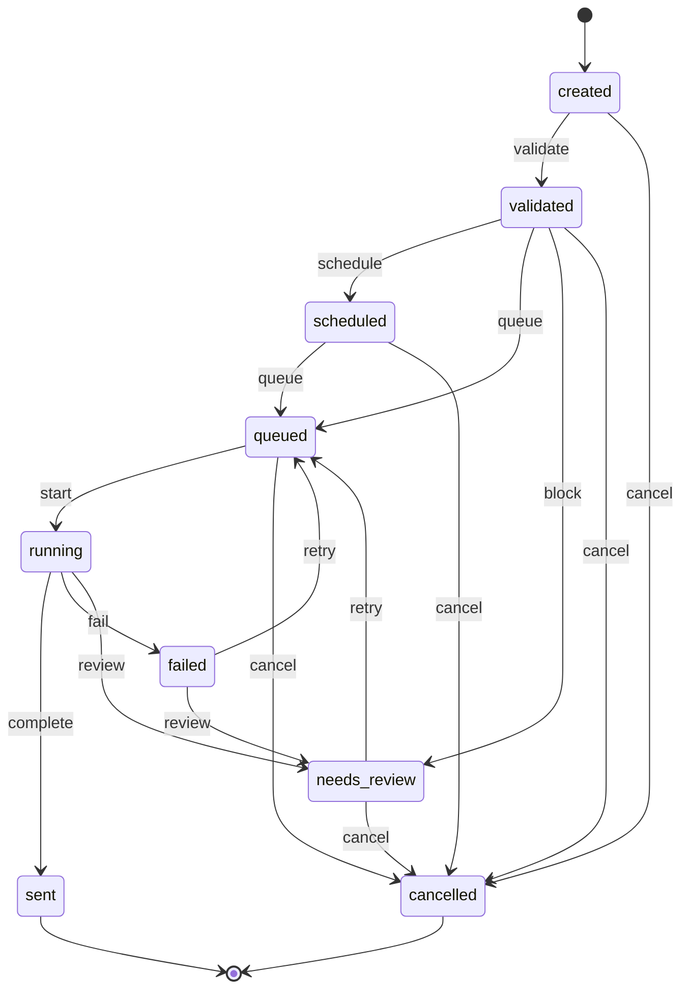

# Email Automation — Workflow State Diagram

## State Descriptions

| State | Description |
|---|---|
| created | Workflow run has been initialized |
| validated | Initial input validation is complete |
| scheduled | Email is waiting for its scheduled time |
| queued | Email is ready for execution |
| running | Email delivery operation is in progress |
| sent | Email provider confirmed successful delivery acceptance |
| failed | An execution failure occurred |
| needs_review | Manual operator review is required |
| cancelled | Workflow was cancelled |
